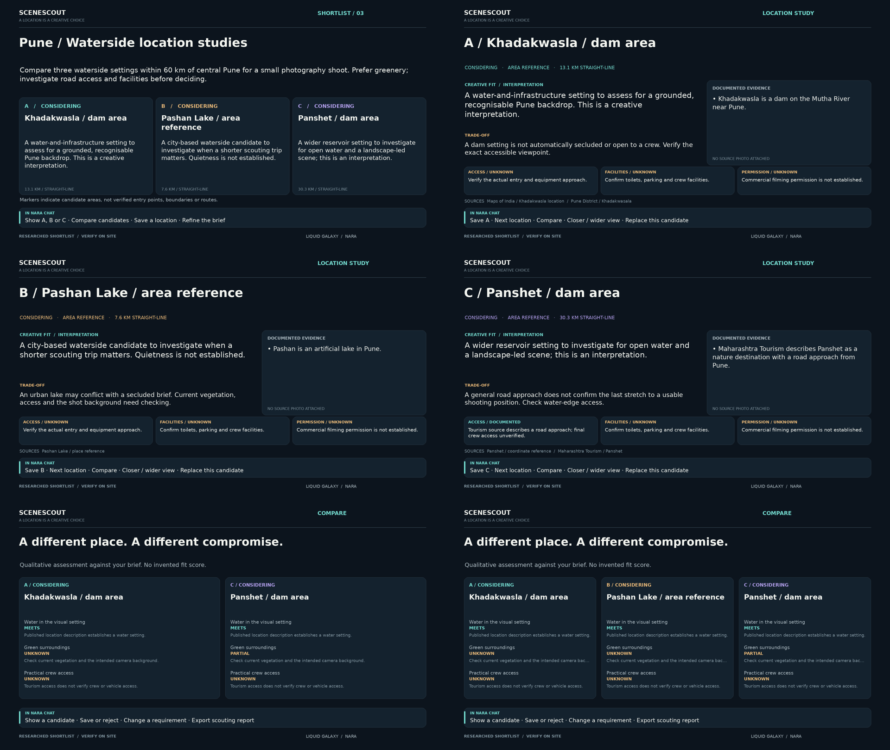

# SceneScout

**From a creative brief to a researched, editable location shortlist on Liquid Galaxy.**

SceneScout is a Nara/Hermes skill for film and photography scouting. Describe the setting you want; Nara researches real candidates and the helper displays them on LG. Save one, reject another, request a replacement, compare the alternatives and export a scouting report.



## The interaction

> Find three waterside settings around Pune for a small photography shoot. Prefer greenery and investigate practical access.

> Show B. Save A. Replace B with somewhere greener, keeping A and C.

> Compare A and the replacement. Export my shortlist, then end scouting.

The helper preserves decisions, notes and the active brief. Saved candidates cannot be replaced without explicit approval. Changing the brief flags retained candidates for reassessment instead of reusing old fit judgments.

## v1.0.1 camera correction

New sessions open directly at candidate A. Showing or advancing to a location uses a 350 m range and 75° tilt by default, including older plans. Overview remains an explicit command. The optional diagnose command checks served panel images and the left client NetworkLink without changing the rig.

## Display

- Left: SceneScout identity, current brief and saved count.
- Centre: small letter markers, a shortlist overview or a close tilted location view.
- Right: creative assessment, source-backed facts or a credited photo, trade-offs, access/facility/permission evidence and next actions.

Individual views default to a **350 m range, 75° tilt**, adjustable from 250–3500 m and 50–78°. Older authored ranges are capped to the close default until the user explicitly requests a wider live view. This is terrain-relative Google Earth imagery, not Street View or a physically accurate lens preview. Actual detail depends on imagery/terrain coverage. Say “closer”, “wider”, or request a different heading without changing your shortlist.

## Requirements

- Existing Nara/Hermes profile and machine-verified `lg-ssh-control` connection.
- Standard odd-screen LG layout (3, 5, 7…), writable web/KML paths on the master and the existing port-81 loading-list mechanism.
- Ubuntu/WSL, Python 3.8+, Pillow 8+, OpenSSH and sshpass. Bundled fonts need no font download.
- A configured AI provider and working search/browser tools for new research and revisions. No paid mapping, photo or speech API is required by the helper. Your model provider's quotas still apply.

## Install

Extract `scene-scout.zip` and run from Ubuntu:

```bash
/usr/bin/python3 /absolute/path/to/scene-scout/install.py
```

If Pillow is absent in this Python:

```bash
sudo apt install -y python3-pil
```

The default existing profile is `liquid-galaxy-agent`. Use `--profile YOUR_PROFILE_NAME` for another existing profile. Installation stages the new files before backing up the old version; it preserves credentials, Classroom, active state and rig content. No SSH connection occurs during installation. Reload the skill in Nara or open a fresh profile chat.

## First real rig run

End any active Classroom lesson through its packaged cleanup. Start Nara and ask:

> Use scene-scout. Start the bundled references/pune-waterside.json, reuse the saved rig connection and completed setup, display the shortlist, then wait. Use /usr/bin/python3 with HERMES_HOME set to my active liquid-galaxy-agent profile. Do not regenerate the prepared brief or inspect Python source.

This is a real researched shortlist, not generated sample observations. It covers water settings, not a verified secluded riverbank brief. Exact shooting positions, current access and filming permissions are intentionally unresolved. Photographs are optional and not bundled without established reuse rights.

The same engine handles newly researched briefs. Ask Nara for your city, radius and creative requirements; it must read supporting sources and generate a new plan instead of substituting Pune.

## Commands

```bash
export HERMES_HOME="$HOME/.hermes/profiles/liquid-galaxy-agent"
ENGINE="$HERMES_HOME/skills/liquid-galaxy/scene-scout/scripts/scout_engine.py"
/usr/bin/python3 "$ENGINE" context
/usr/bin/python3 "$ENGINE" show --id A
/usr/bin/python3 "$ENGINE" camera --range 500 --tilt 70
/usr/bin/python3 "$ENGINE" mark --id A --decision saved --note 'Keep this visual setting'
/usr/bin/python3 "$ENGINE" compare --ids A C
/usr/bin/python3 "$ENGINE" export --output "$HOME/scene-scout-report"
/usr/bin/python3 "$ENGINE" end
```

Normal users request these actions in Nara; Nara invokes the helper in the same conversation. `continue` retries the intended display without repeating a replacement. `context` restores the session in a fresh chat. `continue --voice` enables local narration; `--silent` disables it. Voice is output only, using Windows System.Speech through WSL interoperability or installed espeak-ng/say. No microphone capture is included.

## Evidence and limits

Facts link to actual sources and access dates. Creative fit is labelled interpretation. General tourism access is not proof of equipment access, filming permission, current crowd levels or safety. Distances are straight-line; the skill invents no driving routes or travel times. Markers represent areas, not parcel boundaries or authorised entrances. Google imagery attribution remains visible.

Local optional photos require an absolute file path, author credit, source reference and reuse rights. The helper imports a downscaled copy; it never silently downloads source images. If unavailable, the right panel shows documented evidence instead.

Exports include Markdown, a readable local HTML report, and GeoJSON. They retain decisions, notes, coordinates, criterion reasoning, sources, unknowns and visit checks. They do not reserve a venue or obtain a permit.

End serves empty KML before removing owned loading links, restores owned side panels and retains session records. It preserves another app's later links/panels. Ended sessions can be exported but not continued. Avoid running simultaneous LG apps that compete for the same side panels.

## Documentation and tests

- [Skill instructions](SKILL.md)
- [Plan format](PLAN_FORMAT.md)
- [Acceptance test](ACCEPTANCE.md)
- [Sources and provenance](SOURCES.md)
- [Validation record](VALIDATION.md)

```bash
/usr/bin/python3 -m unittest discover -s tests -v
```

Local tests cover the state workflow, rendering, coordinate/evidence validation, camera constraints, report escaping, photo import, interrupted deployment and real shell/remote-script cleanup against a local filesystem test double. They are not a claim of live SceneScout rendering on the contributor's rig. Complete ACCEPTANCE.md once after installation.

## License and credits

Apache-2.0. Adapted transport and local narration from Globe Classroom; earlier MIT notice retained. DejaVu fonts retain their bundled license. Nara/Hermes and Harsh Mehta's Liquid Galaxy integration provide the host ecosystem. Referenced source text/images and Google Earth imagery retain their original rights. No credentials or imported Hermes profile are included.
